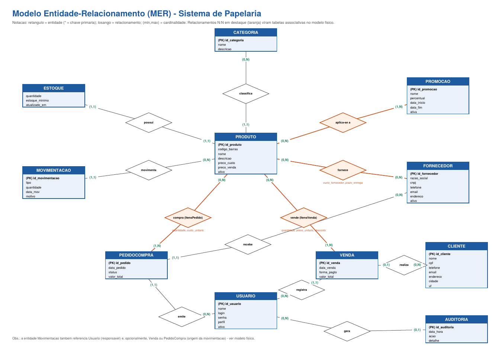
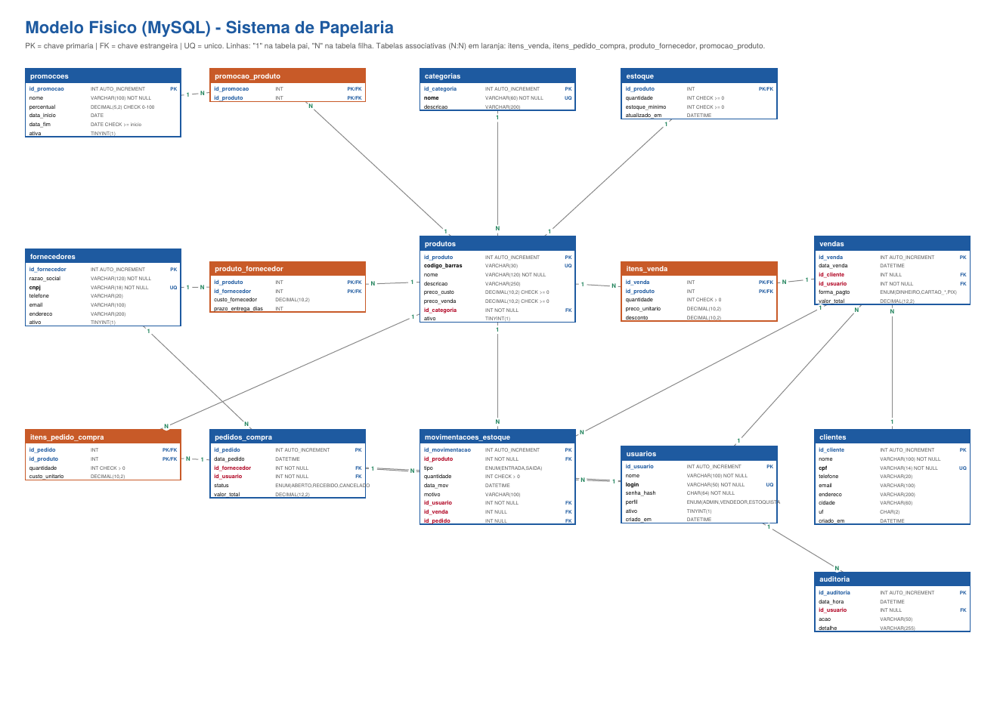

# 🗂️ Sistema de Gerenciamento de Papelaria

Sistema desktop completo para gerenciar uma papelaria: clientes, produtos, fornecedores, categorias, usuários, controle de estoque, vendas e relatórios.
Projeto final da disciplina **Programação Visual**.

## 🎯 Objetivo
Consolidar, em um único sistema, os conteúdos da disciplina: modelagem de banco de dados (MER e modelo físico), MySQL, C# Windows Forms, programação orientada a objetos, camada de acesso a dados (DAO), CRUDs, relacionamentos entre tabelas, controle de estoque, vendas e documentação técnica.

## 📝 Descrição da aplicação
A papelaria vende materiais escolares e de escritório, informática, livros, cadernos, canetas, impressoras e cartuchos. O sistema permite:

- Login de usuário com perfis (**ADMIN**, **VENDEDOR**, **ESTOQUISTA**) e controle de permissões no menu
- CRUD de clientes, produtos, fornecedores, categorias e usuários
- Pesquisa de clientes e de produtos, com filtro por categoria
- Controle de estoque, movimentação (entrada/saída) e consulta de produtos com estoque baixo
- Registro de venda com cálculo automático do total e **baixa automática no estoque** (em transação)
- Desconto automático quando o produto está em promoção ativa
- Histórico de vendas, relatório por período (total, ticket médio, ranking de produtos) e exportação para CSV/Excel
- Dashboard com indicadores (vendas do dia e do mês, estoque baixo, clientes)
- Auditoria de operações (tabela `auditoria`)

## 🛠️ Tecnologias
| Camada | Tecnologia |
|---|---|
| Interface | C# Windows Forms (.NET 8) |
| Banco de dados | MySQL 8.0+ |
| Driver | MySqlConnector (NuGet) |
| Versionamento | Git / GitHub |

## 👥 Integrantes
| Nome | RA |
|---|---|
| _Nome do integrante 1_ | _RA_ |
| _Nome do integrante 2_ | _RA_ |
| _(até 10 integrantes)_ | |

## 🗄️ Modelo do banco de dados
- **15 tabelas**, com PKs, FKs, UNIQUE, CHECK e índices
- **4 relacionamentos N:N**: `itens_venda` (Venda×Produto), `itens_pedido_compra` (Pedido×Produto), `produto_fornecedor` (Fornecedor×Produto), `promocao_produto` (Promoção×Produto)
- 2 views: `vw_estoque_baixo` e `vw_relatorio_vendas`

Documento completo (MER, modelo físico, dicionário de dados, normalização e decisões): [`Docs/Modelagem_Papelaria_MER_e_Fisico.pdf`](Docs/Modelagem_Papelaria_MER_e_Fisico.pdf)

**MER**


**Modelo físico**


## 📁 Estrutura do projeto
```
Papelaria/
├── Banco/script_papelaria.sql     # criação do banco + massa de teste
├── Docs/                          # PDF das modelagens, imagens e screenshots
├── PapelariaApp.sln
└── PapelariaApp/
    ├── Model/    # classes de domínio (Cliente, Produto, Venda, ItemVenda...)
    ├── DAO/      # acesso a dados (ClienteDAO, ProdutoDAO, VendaDAO, EstoqueDAO...)
    ├── Data/     # Conexao, Db (SQL parametrizado), Sessao, Seguranca
    └── Forms/    # telas (Login, Principal, CRUDs, Venda, Estoque, Histórico)
```

## ⚙️ Passo a passo para instalação
**Pré-requisitos** (Windows):
1. [.NET 8 SDK](https://dotnet.microsoft.com/download/dotnet/8.0) (ou Visual Studio 2022 com a carga *Desenvolvimento para desktop com .NET*)
2. [MySQL Server 8.0+](https://dev.mysql.com/downloads/mysql/) e, opcionalmente, o MySQL Workbench
3. Git

**Clonar o projeto**
```bash
git clone <URL-DO-SEU-REPOSITORIO>.git
cd Papelaria
```

## 🧱 Passo a passo para criação do banco
**Pelo MySQL Workbench:** `File > Open SQL Script...` → selecione `Banco/script_papelaria.sql` → execute com o raio (⚡).

**Pela linha de comando:**
```bash
mysql -u root -p < Banco/script_papelaria.sql
```
O script recria o banco `papelaria` do zero, cria tabelas e views e insere a massa de teste (usuários, categorias, produtos, clientes, fornecedores, promoções, vendas e pedidos).

**Configure a conexão** em `PapelariaApp/Data/Conexao.cs` (altere `Uid` e `Pwd`) **ou** defina a variável de ambiente:
```bash
setx PAPELARIA_CONN "Server=localhost;Port=3306;Database=papelaria;Uid=root;Pwd=SUA_SENHA;"
```

## ▶️ Passo a passo para execução
**Visual Studio:** abra `PapelariaApp.sln` → defina `PapelariaApp` como projeto de inicialização → `F5`.

**Linha de comando:**
```bash
cd PapelariaApp
dotnet restore
dotnet run
```
Os pacotes NuGet são restaurados automaticamente.

### Usuários de teste
| Login | Senha | Perfil | Acesso |
|---|---|---|---|
| `admin` | `admin123` | ADMIN | Tudo |
| `maria` | `vendas123` | VENDEDOR | Clientes, vendas, histórico |
| `joao` | `estoque123` | ESTOQUISTA | Produtos, fornecedores, categorias, estoque |

## 🔒 Requisitos técnicos atendidos
- Comandos SQL **parametrizados** em toda a camada DAO (sem concatenação de texto)
- **Transações** em operações críticas (venda, cadastro de produto, movimentação de estoque) com `SELECT ... FOR UPDATE`
- Tratamento de exceções com mensagens amigáveis (`Db.Mensagem`)
- Validação de campos obrigatórios, CPF/CNPJ (nº de dígitos), e-mail e valores numéricos
- Separação em camadas: Model / DAO / Forms / Data
- Senhas armazenadas como hash SHA-256

## ⭐ Diferenciais implementados
Dashboard com indicadores • Controle de permissões por perfil • Exportação para CSV (abre no Excel) • Tema visual personalizado • Sistema de promoções com desconto automático na venda • Auditoria de operações

## 🖼️ Screenshots
> Insira aqui os prints do sistema em execução (salve em `Docs/screenshots/`).

| Login | Dashboard |
|---|---|
|  |  |
| **Nova venda** | **Estoque** |
|  |  |

## 📄 Licença
Projeto acadêmico.
